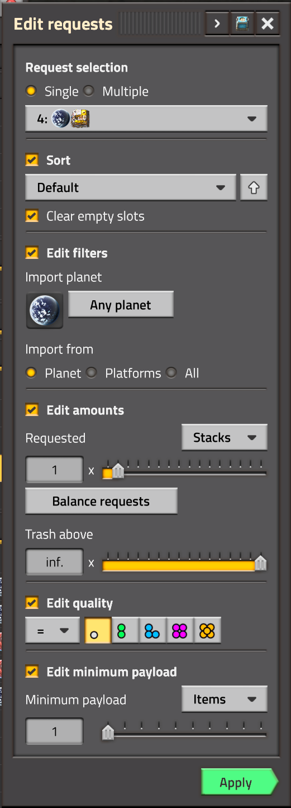
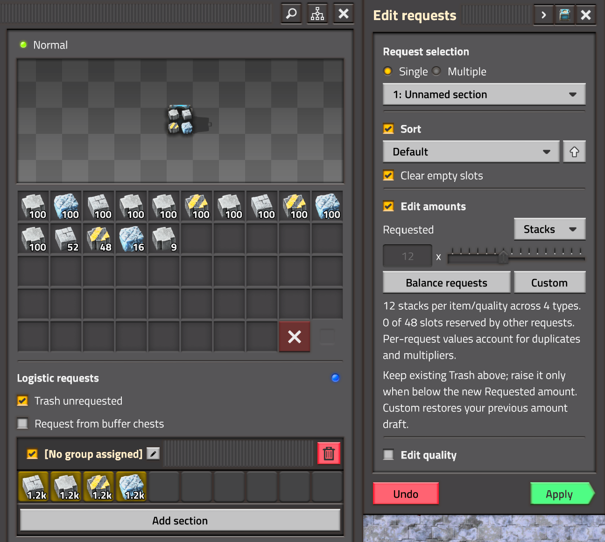
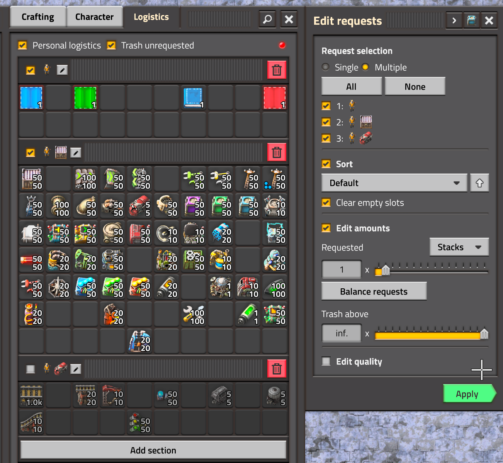
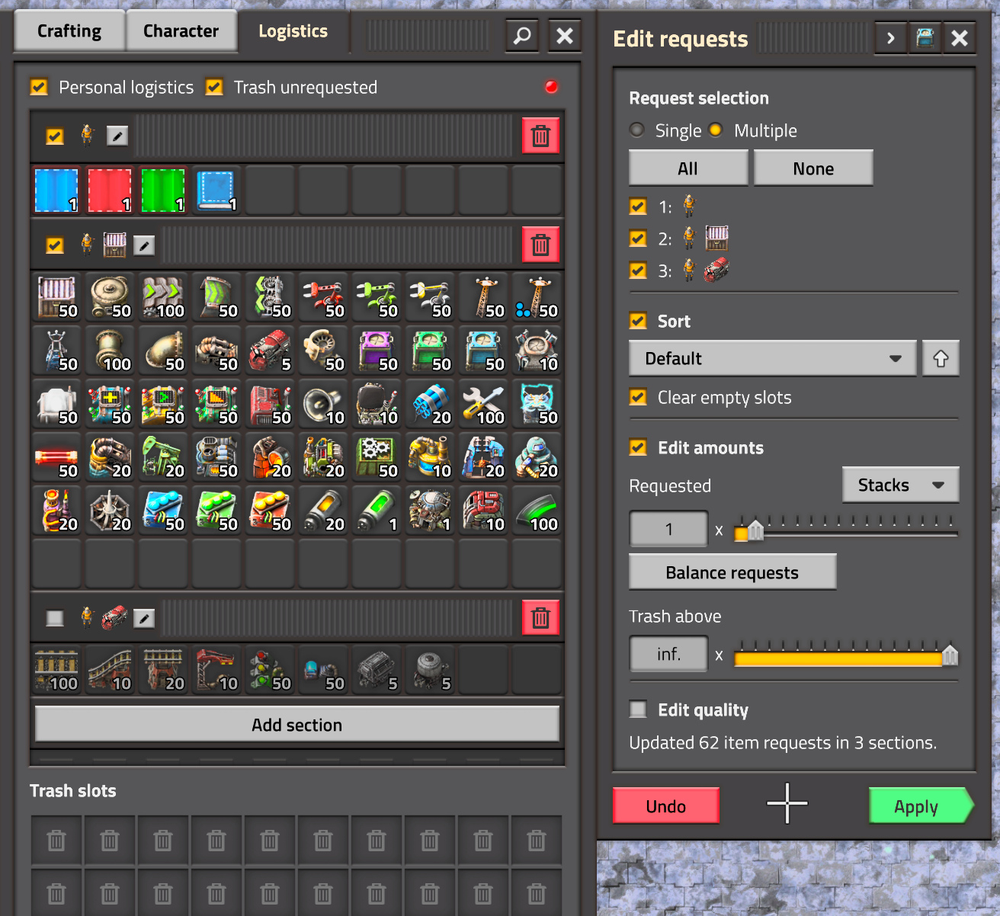
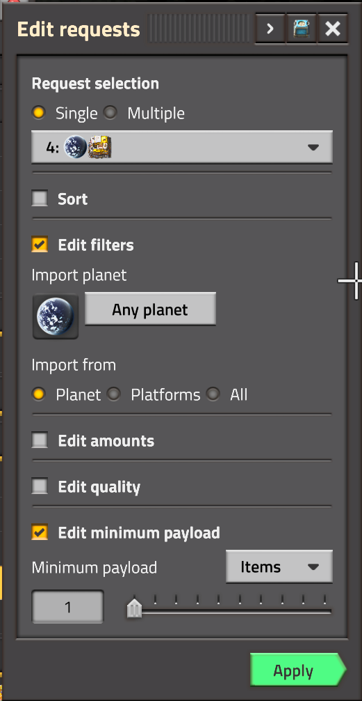
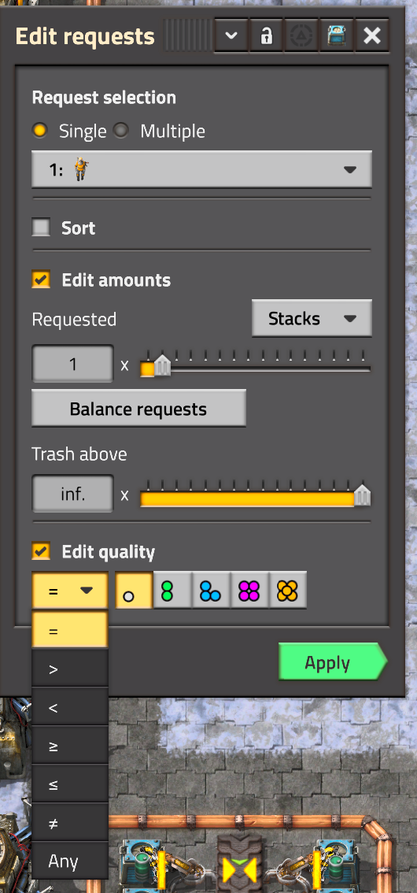
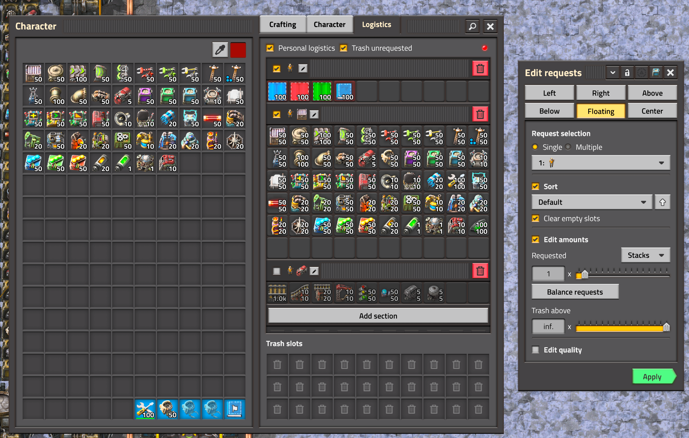
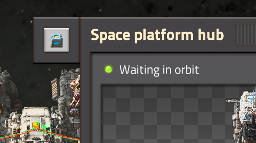
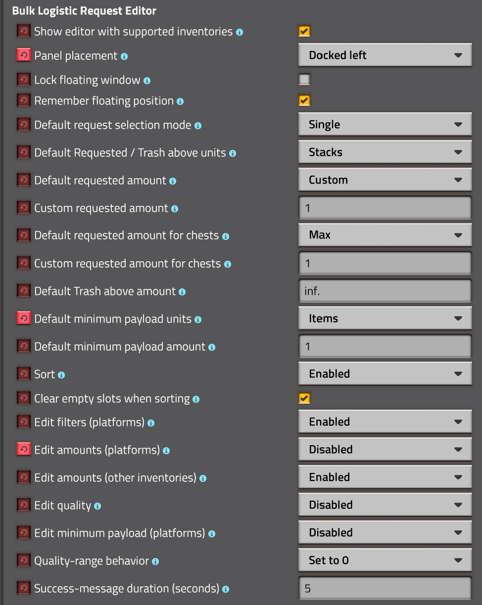

# Bulk Logistic Request Editor

**Less clicking. More factory.**

Sort, balance, and bulk-edit your logistics requests without opening every item
individually. Work on one section or several selected sections, review your
changes, then **Apply**.

> **Requires Factorio 2.1 and Space Age.**
> The editor leaves item stack sizes and inventory capacities unchanged.

[Get started](#using-the-mod) |
[Screenshots](#screenshots) |
[Player options](#per-player-options) |
[Mod Portal draft](MOD_PORTAL.md) |
[Screenshots and publishing](docs/PUBLISHING.md)

---

## Features at a glance

- **Batch-edit requests.** Select one section or use Multiple with All / None to
  work on several sections together.
- **Choose items or stacks.** Set Requested and Trash above with sliders or
  exact numeric input. Chests can start with a full-capacity Max default.
- **Balance requests.** Distribute equal whole-stack or whole-item targets in the
  selected unit, accounting for reserved slots and active requests outside your selection.
- **Keep requests organized.** Sort by native item order, displayed name,
  amounts, or quality, with additional platform properties, two priorities,
  and independent direction toggles.
  Optionally clear empty gaps.
- **Edit quality in bulk.** Use familiar quality buttons, comparison operators,
  and Any quality, with safeguards for incompatible conditions.
- **Manage platform imports.** Set an import planet, choose Planet / Platforms /
  All, and customize minimum delivery payloads.
- **Apply with a way back.** Requests do not change until Apply. One-level Undo
  restores the previous batch while the editor remains open.
- **Make the panel your own.** Dock, float, lock, minimize, or hide it. Window
  preferences are shared across your inventories; each edit category can start
  Enabled, Disabled, or Hidden.

> **Example:** A 48-slot chest with four unique item types and no other
> reservations can be balanced in Stacks mode to **12 stacks per type**. Existing trash
> thresholds stay unchanged unless they need to be raised to match.

---

## Screenshots

<details>
<summary>View screenshot gallery</summary>

### Platform overview



### Balance requests



### Sorting before and after





### Platform controls



### Quality controls



### Floating and minimized panels





### Player options



</details>

---

## Supported request inventories

- Space-platform hubs.
- Your personal logistics requests, once character requester logistics is unlocked.
- Requester and buffer chests.
- Spidertrons.
- Tanks and other logistics-capable car prototypes. Vanilla cars have no
  Logistics tab and are not changed; cars can be edited if another mod gives
  them logistics requests.
- Cargo landing pads.

Open the inventory you want to edit. Ordinary chests, provider/storage chests,
automatic sections, and other inventories without supported logistics requests
are not edited.

## Using the mod

1. Restart Factorio and enable **Bulk Logistic Request Editor**.
2. Open a supported requester, or your character inventory for personal requests,
   and the editor opens automatically by default. **Bulk request editor** in
   Factorio's shortcut bar toggles it on or off. If its chest-and-check icon is
   hidden, enable it in the shortcut-bar customization menu. Visibility is
   remembered across supported inventories.
3. Under **Request selection**, use **Single** to select one section from the
   dropdown, or **Multiple** to choose sections from the scrollable checkbox list.
   **All** and **None** check or uncheck every section in that list.
4. Leave **Sort** checked to use **Default** item ordering, or choose another
   property and **Ascending / Descending**. Uncheck it to keep the current order.
5. On platforms, leave **Edit filters** checked to choose a planet (or **Any planet**)
   and **Planet**, **Platforms**, or **All**. Uncheck it to leave existing imports alone.
   This entire filter section is hidden and ignored for other inventories.
6. Check **Edit amounts** to set **Requested** and **Trash above**. The single
   **Items / Stacks** selector beside Requested controls both amounts.
   **Balance requests** stages a balanced requested amount while preserving or
   raising each request's existing trash threshold.
7. Optionally check **Edit quality** to set a quality level and comparison.
8. On platforms, optionally check **Edit minimum payload** below Edit quality.
9. Click **Apply**. The panel reports how many requests changed.

For example: Fulgora + Planet, Nauvis + Platforms, or Any planet + All.

> **Before applying:** This is a bulk replacement form, not a display of the
> selected requests' current values. Review the checked categories and proposed
> values first. Sort and Edit amounts start enabled; platforms also enable
> Edit filters.

On platforms, Edit filters and Edit amounts start on. Other inventories
open with amount editing enabled and platform filters hidden. Edit quality is
available everywhere and starts off. Each checkbox hides its controls when off,
and Apply ignores that category. At least one category must be enabled.
Minimum payload editing is platform-only and starts off.
Sort starts on for all supported inventories.
These are the initial defaults; every edit category can be configured separately
in the per-player options.
Compact native-style controls, clear category headings, and a scrolling body
keep the editor usable without covering the entire inventory. Long section
names keep their tooltips.

Apply and Undo confirmations disappear after the configured game-time duration
(five seconds by default).
Validation errors stay visible until the form or message changes; they are not
hidden by an earlier confirmation's timer.

## Docking and floating

The editor opens with supported inventories by default. Its launcher is a remembered show/hide toggle:
closing an inventory hides the window but keeps the visible preference on for
the next supported inventory. X or the launcher explicitly turns the editor off.
The shortcut is disabled outside supported inventories, without forgetting that
preference.

The editor is initially docked to the right of the inventory. The title-bar
placement button opens a menu with **Left**, **Right**, **Above**, **Below**,
**Floating**, and **Center**. Floating windows can be moved by dragging their
title bar. The same placement choices are available in Mod settings.

The chest-and-check button beside the title-bar X **minimizes** the editor to
that same icon, matching its shortcut-bar launcher and mod thumbnail. The compact frame sizes
naturally around the icon with equal padding on all four sides rather than a
fixed width. Click the compact icon to restore the full panel at its original
width and padding. This works docked or floating and keeps the underlying
inventory open, along with all draft values, selections, messages, and Undo.
The placement menu closes when minimizing; it can be reopened after restoring.
Automatic updates and confirmation timers continue while minimized.

Floating position and lock state are preserved; restore the title bar to drag
an unlocked window. Placement changes keep the minimized state, while **Reset request editor
position** expands and centers it. Minimizing does not turn off the remembered
visibility preference. Closing the editor or its inventory discards the temporary
form and Undo, but keeps whether the panel was minimized or expanded.
Show/hide and minimize/restore are shared **per player**, not per inventory:
minimizing a chest's editor also minimizes the next platform, personal inventory,
or other supported requester you open. Hiding keeps it hidden until the launcher
or Show editor option turns it back on; showing it again retains the last
minimized/restored choice. Restoring the icon remembers the expanded state.
The panel and minimized icon are both absent when no supported inventory is open.

While floating:

- The **padlock button** shows the current state: closed means locked, open means
  unlocked. Click it to prevent or allow title-bar dragging.
- The **Center** button recenters the window and resets its remembered position.
- Display-resolution or GUI-scale changes recenter it when necessary.

Each player keeps their visibility, placement, and lock state in per-player Mod
settings. Floating positions are stored with the save when position remembering
is enabled. Dragging keeps the title bar reachable on screen, and a scrolling
body limits vertical growth so the editor can be recovered on smaller displays.

For emergency recovery, bind **Reset request editor position** in **Settings >
Controls**. It is unassigned by default. It switches to Floating, recenters and
reveals the editor, and keeps an open form and Undo intact. Without a supported
inventory open, it prepares the next one to open centered. This action does not
change requests or reset the other options.

Switching docking modes preserves the current form, checked sections, messages,
and Undo. It does not apply requests. Closing with **X**, clicking the
shortcut again, closing the inventory, or leaving the game discards the temporary
form and Undo; the next opening uses the usual fresh form defaults. Rejoining,
dying, or changing forces also resets the temporary form and Undo while keeping
preferences. A still-open supported inventory can immediately get a fresh editor
when visibility is enabled, using the remembered minimized/restored state.

## Per-player options

Open **Settings > Mod settings > Per player** and find **Bulk Logistic Request
Editor**.

| Option | Initial default |
| --- | --- |
| Show editor with supported inventories | On; synchronized with the shortcut and editor X |
| Panel placement | Docked right |
| Lock floating window | Off; synchronized with the padlock button |
| Remember floating position | On |
| Default selection mode | Single |
| Default Requested / Trash above units | Stacks |
| Default requested amount | Custom; 1 in the configured unit |
| Default requested amount for chests | Max |
| Custom requested amount for chests | 1, used only with Custom |
| Default Trash above | `inf.` |
| Default minimum payload | 1 stack |
| Sort | Enabled |
| Clear empty slots when sorting | On |
| Edit filters, platforms | Enabled |
| Edit amounts, platforms | Enabled |
| Edit amounts, other inventories | Enabled |
| Edit quality | Disabled |
| Edit minimum payload, platforms | Disabled |
| Quality-range behavior | Set to 0 |
| Success-message duration | 5 seconds |

Each category uses a native dropdown: **Enabled** starts its checkbox checked,
**Disabled** starts it unchecked, and **Hidden** removes the category from the
panel and excludes it from Apply. Factorio's native Mod Settings screen does not
support custom radio groups.

Window options apply to an open editor immediately. Form defaults and visible
category defaults are used only for a fresh editor, not when moving or redocking
one. Hiding a category also takes effect immediately.
Changing options never edits requests without Apply.

Requested defaults have **Custom / Max** choices with separate numeric Custom
values for chests and other requesters. **Max** opens in Stacks mode and shows
the current usable main-inventory slot count numerically: for example, **48** for
an unrestricted normal requester chest. It honors inventory bars and current size
bonuses. Max initializes the form; subsequent capacity changes update the slider
stops without overwriting your entered number. With Custom, Items mode continues
to mean raw item counts.

Trash above accepts a whole amount or `inf.`. The default payload amount is a
text option so it can represent the full unsigned range. Invalid defaults are
shown as validation errors when their edit category is enabled; no replacement
value is silently applied.

On upgrade, existing visibility, floating/docked mode, lock, and position
preferences are retained. The first three migrate once into options that still
have their initial default values; non-default configured options are respected.
Existing boolean edit-category preferences also migrate once to the new
Enabled/Disabled options. Configured non-default states, including Hidden, are
not overwritten.

## Sorting

**Sort**, immediately after Request selection, reveals a required **First by**
priority and an optional **Then by** priority. Each dropdown has a small direction
button on its right: an **up arrow** means ascending, and a **down arrow** means
descending. Click an arrow to reverse that priority's direction.

The secondary priority only orders items tied on the primary value, within each
selected section. For example, **Quality descending, then Name ascending**
groups higher qualities first and alphabetizes items inside each quality group.
**None** disables the secondary priority.

**Default** follows group order, subgroup order, then item order from
Factorio's prototype metadata, including modded items. Names break metadata ties;
quality and comparison distinguish requests for the same item. This follows
native item ordering rather than choosing among an item's crafting recipes.
Default as the primary priority hides the First by label and the secondary
controls, treating Secondary as None. The secondary label is simply Then by;
choosing None disables the secondary priority without hiding the available controls.

Each dropdown omits the property selected in the other. Secondary Default is also
omitted when both directions match, because native order is already the final
tie-breaker. If changing a direction makes Secondary Default redundant, it is
cleared to None with a notice. Other valid combinations remain available even if
the current requests happen not to need additional tie-breaking.

Other properties are **Name**, **Requested amount**, **Quality**, and **Trash
threshold**. Platforms additionally offer **Import planet**, **Import source**,
and **Minimum payload**. All support Ascending and Descending.

- Name uses displayed names in the player's language. Apply waits for
  translations; failures leave requests unchanged.
- Requested, trash and payload sorting share an Items / Stacks choice between
  the two priorities, independently of amount-edit units. Stacks compares the
  count divided by that item's stack size.
- Unlimited trash sorts last ascending and first descending.
- Any planet sorts before specific planets ascending. Specific planets follow
  their ordering metadata. Import sources follow Planet, Platforms, All.
- Automatic/default payload sorts before explicit positive payloads ascending.
- Remaining ties use Default ordering in the primary priority's direction.

Sorting uses the final proposed values, so combined amount, quality, import or
payload edits affect the resulting order. Whole request records move together.
**Clear empty slots**, enabled by default inside Sort, packs requests into
consecutive slots starting at slot 1, removing empty gaps and trailing entries.
Requests with zero Requested counts are still kept. Uncheck it to sort only
between already-occupied slots and preserve the gaps. Its per-player option
sets the default for fresh editors.

Each selected section is sorted independently. Named groups retain global
sharing. Clearing has no effect when Sort is unchecked. Nothing changes until
Apply, and Undo restores the original order, values, and empty-slot positions.

## Quality

Check **Edit quality** to show the native quality-icon buttons and comparison
dropdown. The default proposed condition is **= Normal**. Research-locked
qualities are disabled; their availability updates automatically after unlocks.
Modded visible quality levels are listed in order and wrap to additional rows.
The quality buttons and comparison dropdown use the native 28 px control height.
Apply and Undo use the same compact height and standard button font.

Choose **Any** in the comparison dropdown to match any quality. The quality
buttons are disabled while Any is selected, retaining the previous level for
when you switch back to a comparison. Like other range filters, Any requires
Requested = 0 and supports Undo.

Only checked edit categories change. To edit quality alone, uncheck the other
edit categories.

Positive requested amounts require one exact quality (`=`). Other comparisons
are trash-only and require Requested = 0. **Quality-range behavior** controls
what Apply does:

- **Set to 0** (default) zeros Requested for affected filters when editing quality
  or amounts, even if Edit amounts is unchecked. It does not change Trash above
  beyond any amount edit explicitly requested. A confirmation explains the
  zeroing, and Undo restores the previous values.
- **Prevent** refuses the entire batch instead. Set Requested to 0 explicitly,
  or choose an exact quality, before applying.

If applying quality would make two filters for the same item identical within
a section, the entire batch is refused instead of merging or losing requests.
The same item in different sections is allowed.

Quality edits preserve item types, quantities and imports unless
their categories are also checked, except for Requested zeroing under the
configured quality policy. Slot positions are preserved when Sort is unchecked.
They participate in shared groups and Undo just like
other edits.

## Undo

**Apply** stays at the lower right. After a successful Apply, the red **Undo**
button appears at the lower left. The footer has extra space above its buttons,
reserved from the scrolling body's height budget on smaller screens.
Undo restores the request
values and item order from immediately before that Apply, including every section in its batch.
It does not depend on the current form values or section selection.

Only the latest successful Apply is kept per player's open editor. Another
successful Apply replaces that snapshot; a failed Apply does not. Undo can be used
once, then disappears. There is no redo or history list.

Closing the editor or its inventory discards Undo without restoring anything.
Relaunching starts with no Undo available. Docking, undocking, locking, and
centering the open editor do not discard Undo.

Undo refuses the entire batch if any edited request has changed since Apply, or
an edited section changed group or was removed. Reindexing caused by changes to
other sections does not invalidate an otherwise safe Undo. It also respects logistics edit
permissions. This prevents overwriting later edits, including edits made through
another use of a shared group. Restoring an unchanged named group still updates
every use of that group, just like Apply.

## Items and stacks

Requested and Trash above share the single **Items / Stacks** selector beside
Requested. Changing it controls both amounts and keeps the entered numbers; it
does not convert values.
Items applies one absolute count to every item, while Stacks multiplies by each
item's current stack size. Minimum payload has an independent selector.

In Stacks mode, the two linked native amount sliders keep stops at **0, 1, 2, 3,
4, 5, 10, 25, 50, 75, 100, 250, 500, 750, 1000**. The current usable slot capacity
is inserted in sorted position if missing; higher standard stops remain.
A normal 48-slot requester chest therefore includes **25, 48, 50, 75**.
Items mode retains **0, 1, 2, 3, 4, 5, 10, 25, 50, 100, 1000**.
Minimum payload retains its separate presets.

Trash above replaces its final stop with **inf.**, meaning unlimited. Both
sliders have the same number of stops, keeping their ticks aligned. Their
tooltips list the current stops. Defaults are **1 stack requested** outside
chests, **Max** for chests, and **inf. trash above**; these are configurable.

Type other nonnegative whole amounts in either box, including values above
1000. Each resulting requested or finite trash count must be at most
**2,147,483,647 items** for every selected item. Custom values are kept exactly;
the slider indicates the nearest available finite preset and stays at its last
stop for values at or above the largest preset. A slider at its last stop does not turn a typed
finite maximum into infinity. Type `inf` or `inf.` for unlimited.

The controls keep Trash above at least Requested. Raising Requested past a finite
maximum raises that maximum; lowering Trash above below Requested lowers the
request. Dragging Requested to its final endpoint also sets Trash above to inf.
Typing 1000 does not force infinity, so a finite 1000/1000 request is still possible.

For example, **10x requested / 25x trash above** gives an item with stack size 50
a request of 500 and a maximum of 1,250. Every other selected item uses its own
current prototype stack size, including changes made by other mods. Section
multipliers are preserved and still apply on top of these per-request amounts.
With Items selected, 10 requested / 25 trash above instead means exactly 10 and
25 items for every selected item type.

Invalid input or an item-count overflow prevents the entire batch from applying.
Factorio does not allow positive requested amounts with quality-range conditions;
the quality-range policy either sets Requested to 0 or refuses the batch.

## Balancing requests

Under Requested, **Balance requests** stages an allocation for the selected sections;
**Apply** writes it and **Undo** restores the previous requests. **Custom** restores
your preceding numeric draft. Staged balancing survives docking or floating.
Both unnamed sections and named shared groups support balancing requests.

The **Items / Stacks** selector beside Requested also chooses the balancing mode.
You can switch it while balancing is active; the preview recalculates rather than
converting a custom number.

- **Stacks** (default) divides remaining slots equally, rounding down to whole
  stacks per item/quality type.
- **Items** finds the largest equal whole-item target that fits the remaining
  capacity. Partial stacks are allowed, but still count as occupied slots.
  Counts are rounded down to whole items, not to whole-stack multiples.

Any leftover capacity stays unused rather than being redistributed.
For example, with **5 slots** and two item types whose stack sizes are **100**
and **50**, Items mode targets **150 items of each** (2 slots + 3 slots).
Stacks mode targets **2 stacks of each** (200 items + 100 items).

For an unrestricted **48-slot chest with four unique item types**, each type gets
**12 stacks** in Stacks mode. Existing Trash above stays unchanged unless below the new Requested
amount, in which case it is raised to match. Infinite thresholds remain infinite.
Trash controls are hidden during sharing to avoid suggesting the uniform numeric
trash draft will be applied.

The calculation:

1. Uses the current main inventory's usable slots, honoring its bar and size bonuses.
   Filtered/reserved slots (blue slots in the player's inventory) count as taken,
   whether empty or occupied, even if their filter matches a selected request.
   Their filters and contents are not changed. The preview reports the excluded
   slot count. This conservatively excludes those slots rather than attempting
   to assign shared requests to them.
2. Reserves space for active, unedited manual and automatic requests, including
   section multipliers. Counts for the same item and quality are combined before
   rounding their required storage up to whole slots.
3. Uses the selected unit to choose equal whole-stack allocations or equal
   whole-item targets among unique selected item/quality types. Current inventory
   contents do not reduce this target capacity.
4. Shares each type's allocation between duplicate requests and active linked
   section copies, accounting for their multipliers. Individual request counts
   may be partial stacks; their combined effective request fits the allocation.

The preview and Apply use current requests and capacity, not a stale saved
allocation. Request types that require Requested = 0 follow the configured quality
policy; they receive no positive allocation. Other checked edit categories still
apply, and sorting uses the resulting counts.

Balancing refuses insufficient space, selected groups without an active
positive-multiplier copy in this inventory, unavailable capacities, and item-count
overflows rather than partially applying or
silently zeroing requests. The allocation is calculated for the opened inventory;
editing a named group still updates its uses on other inventories globally.

## Minimum payload

On platforms, **Edit minimum payload** reveals a numeric field, an independent
Items / Stacks selector, and a slider. Initially it is unchecked and proposes
**1 stack**; both defaults are configurable. Slider stops are **1, 2, 3, 4, 5, 10, 25, 50, 100, 1000** in the
selected unit. This includes both a single item and a single stack.

Custom positive whole values are allowed. Each resulting minimum delivery count
must be at most **4,294,967,295 items**. Unlike Requested and Trash above, the
payload uses the unsigned 32-bit range and is not constrained by those amounts.
It does not increase a rocket's carrying capacity.

Apply changes minimum payload only when its checkbox is checked. Otherwise
automatic or existing custom payload values stay unchanged. These controls are
hidden and ignored outside platforms. Payload edits support multi-section
selection, shared groups, Undo (including restoration of automatic payloads),
and docking/undocking without losing input.

## Section selection

On the first switch to Multiple, the current dropdown section is checked.
Checkbox selections are kept when switching modes. Single applies only to the
dropdown selection; Multiple applies only to checked sections. Apply is disabled
when nothing is selected. Empty sections in a nonempty batch are skipped and
reported in the result.

Click the title-bar **X** to close only **Edit requests**, leaving the inventory
open and its requests unchanged. Click the shortcut to reopen the editor with
fresh form defaults. Closing an inventory alone does not turn off automatic
reopening with the next supported inventory.

The section list and quality availability update automatically. Slot-change
events and editor interactions provide immediate checks; a lightweight fallback
runs every **60 game ticks** (one second at normal speed), only while the editor
is open. There is no Refresh button. Interaction checks also cover edits made
while the game is paused.

Automatic updates preserve pending form values, messages, Undo, and selections
whose section identities and groups are unchanged. New sections start unchecked.
Unrelated additions, removals, or reindexing do not silently select a different
section. If a selected section disappears or changes group (including renaming),
the entire selection is cleared with a notice. Select the intended sections
again before Apply.

**Named groups remain shared.** Applying to a named group updates all uses of
that group, including uses on other requesters. Repeated uses of the same named
group in a selection are updated once.

Item types, section multipliers, and enabled states are preserved. Occupied slot
positions change only when Sort is checked. Quantities are preserved unless
Edit amounts is checked; imports are preserved unless Edit filters is checked.
The Set to 0 quality policy can additionally clear Requested for range filters.
Quality conditions are preserved unless Edit quality is checked.
Minimum delivery sizes are preserved unless Edit minimum payload is checked.
Automatic sections are not edited. Shared group changes still propagate to any
requester using that group, including a platform sharing a non-platform group.

With the initial options, the panel starts in Single mode with Any planet and
Planet selected. It is a bulk replacement form, not a display of the section's
current (possibly mixed) settings.
Nothing changes until Apply is clicked.

---

<details>
<summary><strong>Developer reference: testing and Factorio APIs</strong></summary>

## Testing

First try the mod in a disposable save. Check a section with mixed import
settings, apply each of the example combinations above, and open individual
requests to verify their imports and unchanged quantities.

The automated integration tests use Factorio's headless test mode with isolated
mods and user data in a disposable directory under `tests`. They do not load your
saves or change your game configuration.

```powershell
powershell.exe -NoProfile -ExecutionPolicy RemoteSigned -File .\tests\run.ps1 -FactorioPath 'D:\SteamLibrary\steamapps\common\Factorio\bin\x64\factorio.exe'
```

The execution-policy setting applies only to that process, not your saved
Windows settings.

The tests exercise matching action-button heights, panel-only closing and hub
reopening, 30 requests, all three sources with and without a planet, Single/Multiple
mode switching, All/None, selected-only batches, shared groups, unchanged request
fields, stale section and batch selection, and permissions.
They also check the narrower layout, control spacing, edit-category visibility,
per-item stack arithmetic, linked slider endpoints, custom multiplier input,
unlimited maxima, overflow/quality-range refusal, and quantity-only batches.
Each supported non-platform requester is tested for amount editing, hidden-filter
isolation, unchanged metadata, and native GUI anchoring. Personal request tests
also cover controller-inventory opening/closing and research availability.
Undo tests cover exact pre-Apply restoration, one-level replacement, failed
Applies, batch conflicts, permissions, shared groups, and discarding history
when the editor closes.
Quality tests cover independent and combined categories, native selection and
unlock behavior, range validation, duplicate prevention, shared groups, Undo,
and non-platform inventories. Confirmation timers are checked at the five-second
boundary and against newer errors.
Placement tests cover automatic opening, optional shortcut launch and remembered visibility,
docking and floating roots, dragging and locking, remembered positions, display
changes, form/message/Undo preservation, stale-section safeguards, and
closing/reopening behavior. Minimize tests cover icon-only layout, restoring
drafts and Undo, docked/floating transitions, position and lock preservation,
confirmation expiry, rescue, and shared window preferences across fresh sessions,
chests, platforms, and personal inventories.
GUI-event tests cover missing elements, destroyed controls, other scripts' GUI
elements, stale player indices, and right-click isolation, followed by successful
owned Apply and Undo actions.
Quantity tests cover linked item/stack units without number conversion, signed
amount limits, independent unsigned payload limits, every payload preset,
automatic/custom payload Undo, disabled/non-platform isolation, and preserving
unit and payload form values while moving the editor.
Options tests use real mod-owned settings writes and cover every edit-category
default, live placement and rescue, defaults that preserve an open form,
confirmation duration, legacy preference migration, and both quality policies.
Synchronization tests check the exact 59/60-tick boundary, slot-change events,
interaction-driven updates without ticks, stable selection and Undo under
reindexing, unsafe-selection clearing, preserved drafts/timers, and hidden editors.
Sorting tests cover all eight properties in both directions, translated-name
readiness/failures, native group/subgroup/item metadata, empty slots, final edits,
stack-normalized counts, stale selections, clearing or preserving gaps, zero-count
requests, configurable clearing defaults, and Undo. Priority tests cover independent
arrow toggles, optional None, Default restrictions, filtered dropdowns, stale GUI
events, secondary name translations and units, final edited values, and backend guards.
Capacity tests verify every standard and inserted slider stop, normal chest Max
defaults, inventory-bar changes without draft resets, actual Max request counts,
48-slot/four-type allocation, unnamed single/multiple sections, preserved or raised trash thresholds, unselected
reservations (including native fractional rounding), aliases, multipliers,
quality-specific shares, reserved inventory slots (empty and occupied), insufficient-space
refusal, and category migration. Unit-aware balancing tests cover equal item counts
with partial stacks, whole-item rounding and leftover capacity, switching units
while staged, live reservations, multiplier-adjusted native counts, and Undo.

## API references

- [LogisticFilter](https://lua-api.factorio.com/latest/concepts/LogisticFilter.html)
- [LuaLogisticSection](https://lua-api.factorio.com/latest/classes/LuaLogisticSection.html)
- [Relative GUI anchors](https://lua-api.factorio.com/latest/concepts/GuiAnchor.html)

</details>
